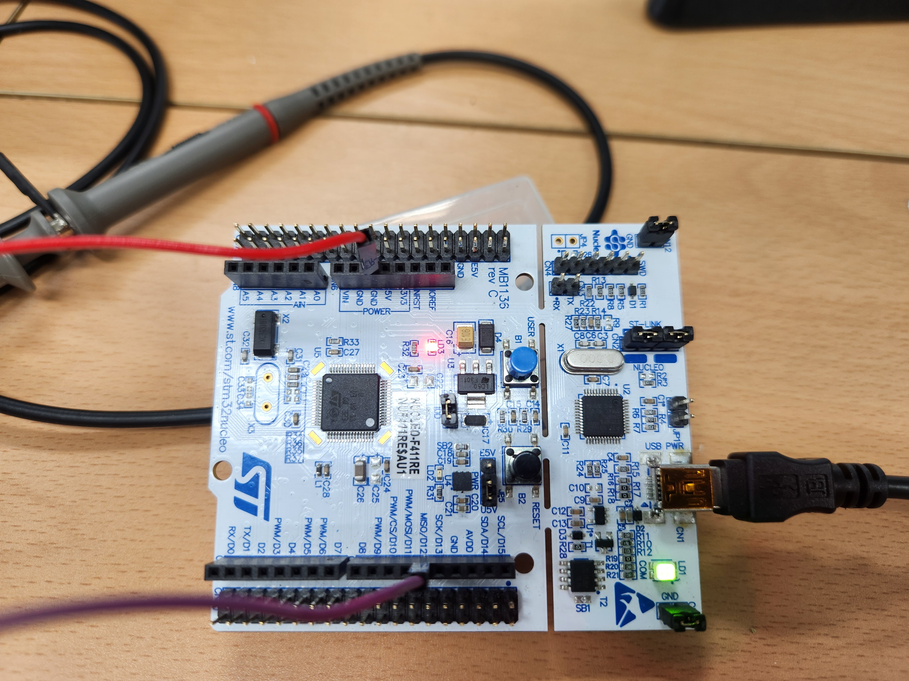
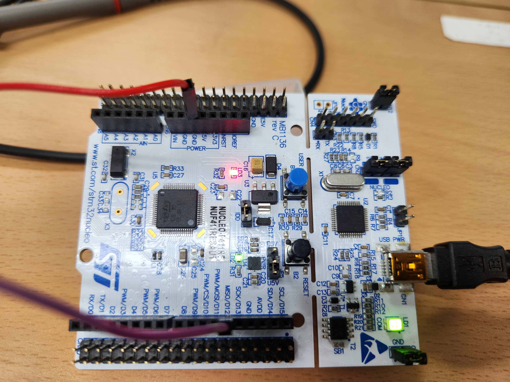
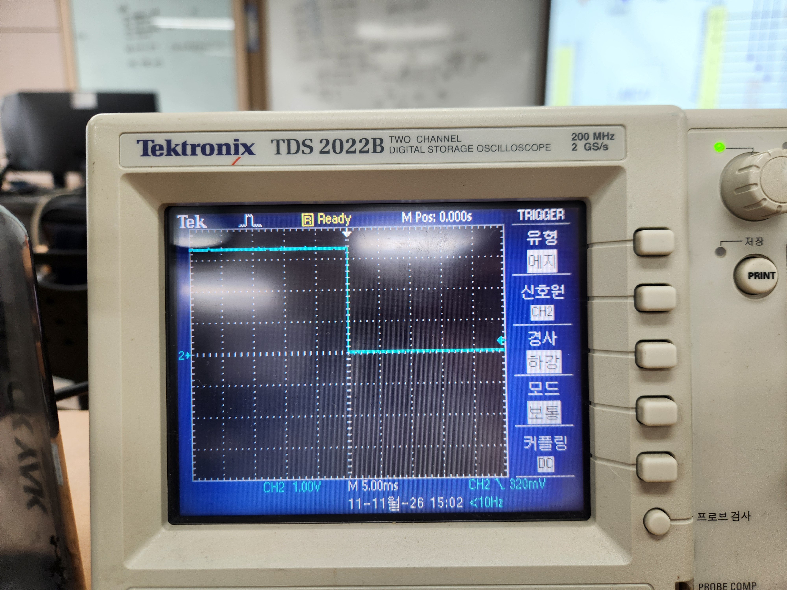
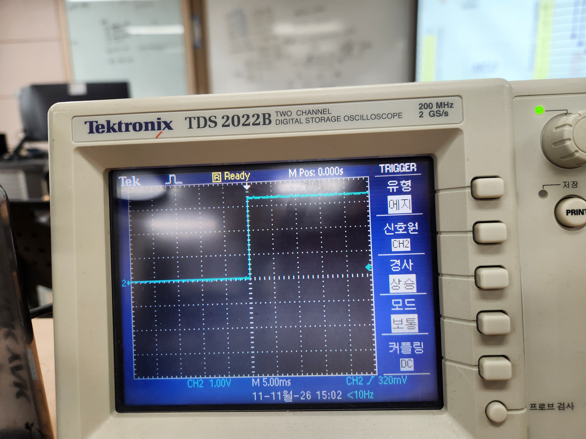

# H1 11.11일 정리본
오실로스코프
- TRIG
모드: 보통:그시간대의 신호가 잡히는걸 그부분만 보인다.
자동: 계속 신호가 돌아간다
- 초기세팅
스코브 연결 > 악어클립을 GND 에 연결 > 나머지를 PROBE COMP를 연결 > 파형이 기울려있을시 스코브 구멍(저항과 커패시터가 있다)에 맞춰 그래프가 수평
- 커플링
DC 위로 AD: 캐패시터 접지: 0

## GPIOA
32BIT
PA 5의 LED을 쓴다. 
-PA 5(LED)
INPUT,OUTPUT,ALTANATE,ANALOG의 역할을 해서 총 기본4개 2BIT가 필요
그렇기에 두개로 나눠 총 32BIT를 쓴다.

  
  

  
  

