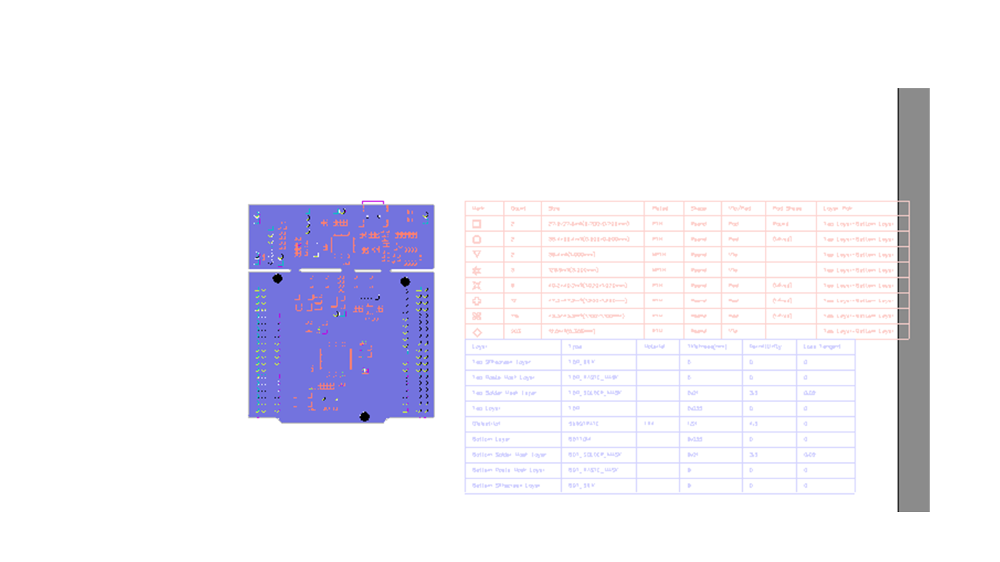
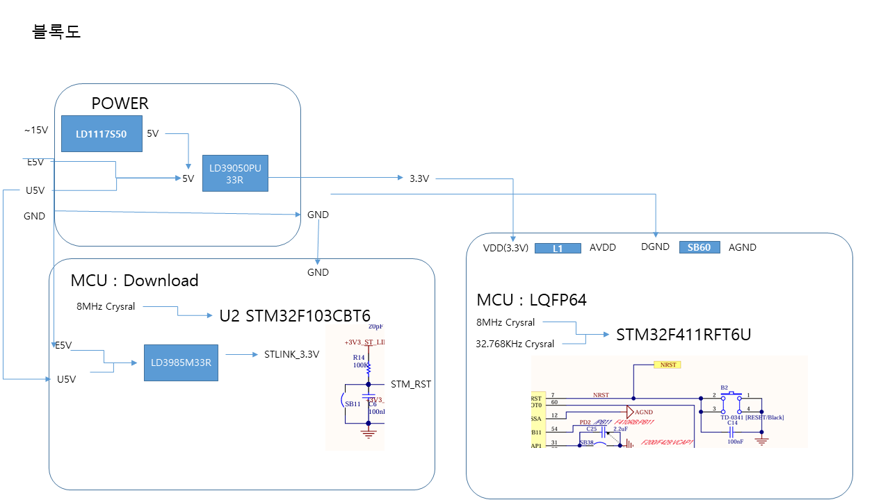
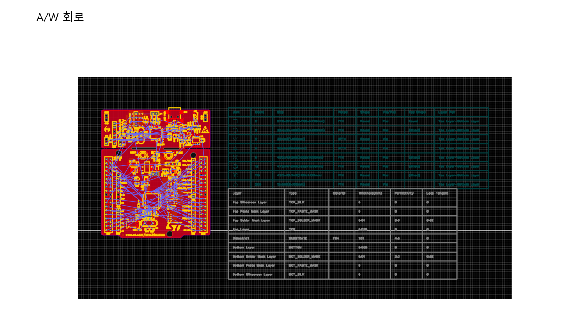
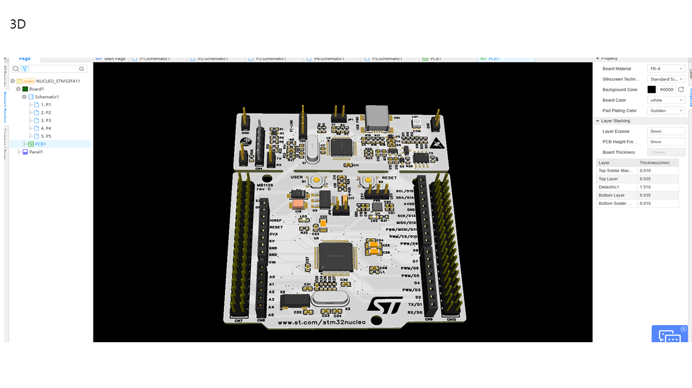

# STM32F411_Project
STM32F411_Project test
# H1 제목
## H2 제목  
### H3 제목
#### H4 제목
##### H5 제목
###### H6 제목
*이탤릭체* 또는 _이탤릭체_

**볼드체** 또는 __볼드체__

***볼드 이탤릭*** 또는 ___볼드 이탤릭___

~~취소선~~

`인라인 코드`
- 항목 1
- 항목 2
  - 하위 항목 1
  - 하위 항목 2
    - 더 깊은 하위 항목

1. 첫 번째 항목
2. 두 번째 항목
   1. 하위 항목 1
   2. 하위 항목 2
3. 세 번째 항목

[네이버](https://naver.com)


https://naver.com

```javascript
function hello() {
    console.log('Hello World');
}
```

```python
def hello():
    print("Hello World")
```

```bash
npm install package-name
```


| 열1 | 열2 | 열3 |
|:-----|:-----:|:-----|
| 데이터1 | 데이터2 | 데이터3 |
| 데이터4 | 데이터5 | 데이터6 |

이것은 인용문입니다.
> 여러 줄의 인용문도 가능합니다.
>
> > 중첩된 인용문
---
$E = mc^2$ (인라인)

$$
\sum_{i=1}^{n} x_i = x_1 + x_2 + ... + x_n
$$

# STM32F411_Project

## Hardware
 <br>



---


# Firmware

<p align="center">
  
</p>

<p align="center">
  
</p>

<p align="center">
  
</p>

<p align="center">
  
</p>

<p align="center">
  
</p>
---
